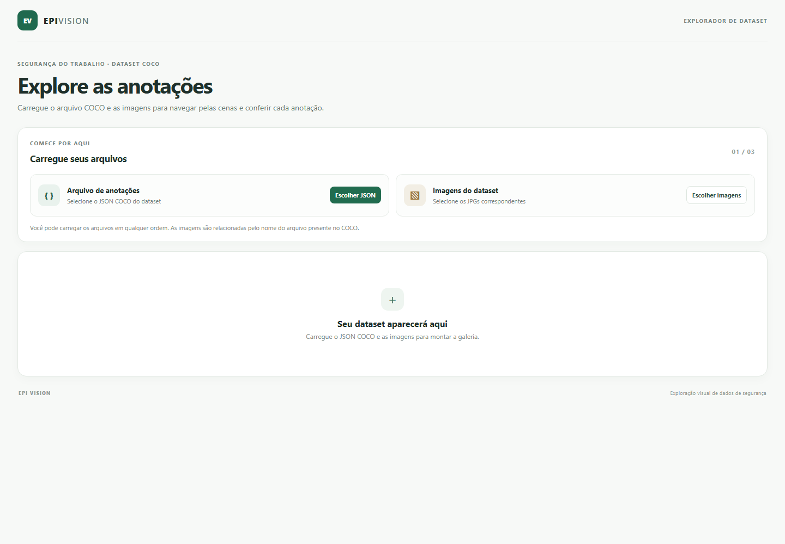
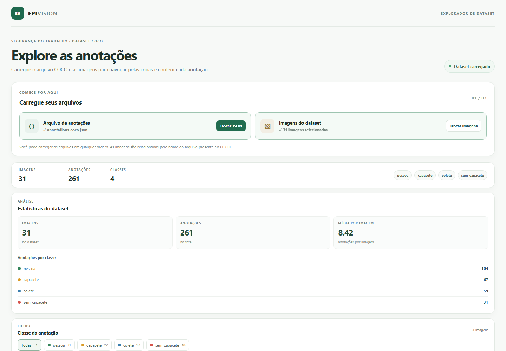
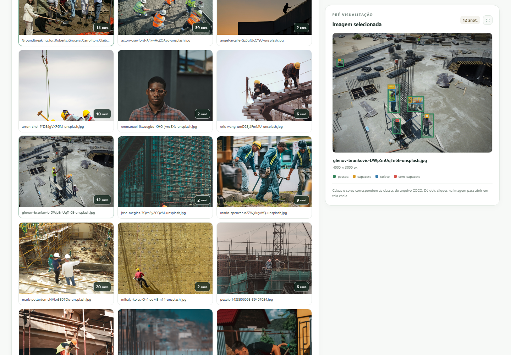
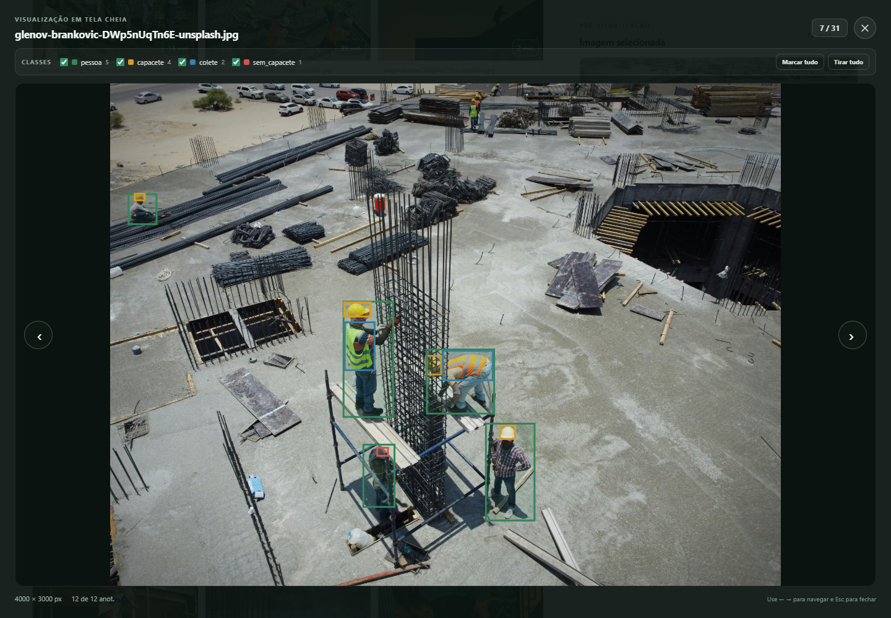
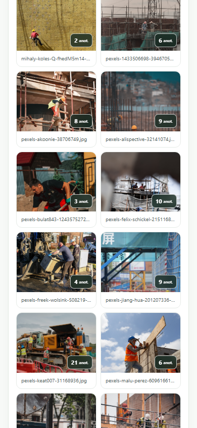

# EPI Vision Dataset

Dataset de detecção de Equipamentos de Proteção Individual (EPIs) em cenas de construção, indústria e ambientes similares, acompanhado de uma aplicação Angular standalone para carregar, visualizar, filtrar e analisar as anotações.

> **Status:** aplicação funcional e validada por testes unitários e E2E em Chromium. A revisão visual final das anotações ainda está pendente; os 31 registros permanecem com `annotation_status=in_review`.

## Índice

- [Visão geral](#visão-geral)
- [Funcionalidades](#funcionalidades)
- [Stack](#stack)
- [Estrutura do repositório](#estrutura-do-repositório)
- [Começando](#começando)
- [Como usar a aplicação](#como-usar-a-aplicação)
- [Scripts](#scripts)
- [Dataset](#dataset)
- [Arquitetura](#arquitetura)
- [Qualidade e testes](#qualidade-e-testes)
- [Documentação](#documentação)
- [Limitações e próximos passos](#limitações-e-próximos-passos)
- [Direitos e uso](#direitos-e-uso)
- [Contribuição](#contribuição)
- [Changelog](#changelog)

## Visão geral

O projeto tem duas entregas complementares:

1. **Dataset** — 31 imagens anotadas com quatro classes (`pessoa`, `capacete`, `colete`, `sem_capacete`), exportadas em COCO JSON e YOLO, com procedência registrada por arquivo.
2. **Aplicação Angular** — explorador que valida o COCO em runtime, associa as imagens carregadas pelo nome do arquivo, desenha as caixas em SVG, oferece filtros e estatísticas e trata erros e estados vazios.

O dataset e o código ficam separados: a aplicação não embute os dados e recebe o COCO e as imagens por upload no navegador. Nenhum arquivo é enviado a um servidor.

## Funcionalidades

### Dataset

- 31 imagens de obras, indústrias e contextos equivalentes.
- 261 anotações COCO/YOLO correspondentes entre si.
- Quatro classes com mapeamento YOLO documentado.
- Catálogo de origem com URL, autor, licença, dimensões, tamanho e SHA-256.
- Exports brutos e derivados do MakeSense preservados para rastreabilidade.
- Validadores read-only para o catálogo de fontes e para pares CSV/ZIP do MakeSense.
- Auditoria geométrica read-only das 261 caixas (`tools/dataset/audit_annotations.py`), separando erros objetivos de avisos que exigem inspeção humana.

### Aplicação

- Upload do COCO JSON com validação estrutural e semântica antes de usar os dados.
- Upload múltiplo de imagens com associação por nome normalizado e confirmação visual do arquivo e da quantidade selecionados.
- Galeria com miniatura lazy, nome e número de anotações por imagem.
- Filtro por classe na galeria, na pré-visualização e nas estatísticas de apoio.
- Pré-visualização com bounding boxes coloridas por classe, usando o `viewBox` original da imagem.
- Pré-visualização sticky em telas largas, acompanhando a rolagem da galeria.
- Visualização em tela cheia por botão, duplo clique na prévia ou duplo clique em um cartão.
- Navegação em tela cheia com ←/→, wrap-around, Esc, foco preso ao diálogo e restauração do foco.
- Filtro de visibilidade por classe na tela cheia, com checkbox por classe presente na imagem e ações **Marcar tudo** / **Tirar tudo** que valem para todas as classes do dataset, inclusive as ausentes na imagem.
- Estatísticas gerais e por classe: imagens, anotações, média por imagem e distribuição.
- Mensagens amigáveis para JSON inválido, falha de leitura e imagens ausentes.
- Estados vazios para dataset vazio, galeria sem resultados e imagem não carregada.
- Layout responsivo e suporte a teclado, mouse e toque nos controles principais.
- Testes E2E com Playwright cobrindo dataset real, upload, galeria, filtros, estatísticas, erros, estados vazios e tela cheia.

## Stack

| Camada           | Tecnologia                                                          |
| ---------------- | ------------------------------------------------------------------- |
| Frontend         | Angular 22.2 standalone, Signals, `OnPush`, templates estritos      |
| Linguagem        | TypeScript 6 em modo `strict`                                       |
| Testes do app    | Vitest 5 + jsdom via `@angular/build:unit-test`                     |
| Testes E2E       | Playwright 1.65 + Chromium (desktop e viewport mobile)               |
| Qualidade        | ESLint 10 + angular-eslint 22, Prettier 3                           |
| Build            | Angular CLI 22 / `@angular/build`                                   |
| Ferramenta local | Node.js 24 com `node:test` e servidor HTTP nativo                   |
| Dataset          | COCO JSON, YOLO, CSV/ZIP do MakeSense e scripts Python (stdlib)     |

**Node.js:** o Angular 22 exige `^22.22.3 || ^24.15.0 || >=26.0.0`. O projeto foi validado com Node.js 24.20.0 e npm 11.19.0. A ferramenta `tools/image-collector` aceita Node.js 20.11+.

## Estrutura do repositório

```text
.
├── app/                         # Aplicação Angular standalone
│   ├── src/app/core/            # Modelos COCO, validador, loader e utilitários
│   ├── src/app/features/dataset # Página e componentes de exploração
│   ├── e2e/                     # Testes Playwright e capturas de tela
│   └── README.md                # Guia operacional da aplicação
├── dataset/
│   ├── images/                  # 31 imagens originais
│   ├── annotations_coco.json    # Anotações COCO
│   ├── annotations_yolo/        # Um .txt por imagem + classes.txt + dataset.yaml
│   ├── annotations/             # Exports brutos e derivados do MakeSense
│   ├── sources/                 # Catálogo de origem (sidecars opcionais)
│   └── README.md                # Conteúdo, validação e pipeline de importação
├── docs/                        # Arquitetura, critérios, decisões, relatórios e capturas
├── tools/
│   ├── dataset/                 # Validadores, importador e auditoria em Python
│   └── image-collector/         # Coleta e catálogo de imagens (Node.js)
├── CHANGELOG.md
├── CONTRIBUTING.md
└── README.md
```

## Começando

### Pré-requisitos

- Node.js compatível com o Angular 22 (ver [Stack](#stack)).
- npm.
- Python 3 para validar/importar exports do MakeSense (testado com Python 3.14.7; usa apenas a biblioteca padrão).

### Instalação e execução

```bash
cd app
npm install
npm start
```

Abra `http://localhost:4200/`.

### Build de produção

```bash
cd app
npm run build
```

A saída é gerada em `app/dist/app/`.

## Como usar a aplicação

1. Selecione `dataset/annotations_coco.json`. Após a validação, o cartão confirma o arquivo com ✓ e o nome escolhido, e o botão passa a **Trocar JSON**.
2. Selecione todas as imagens de `dataset/images/`. O cartão confirma a quantidade selecionada e o botão passa a **Trocar imagens**.
3. Escolha um cartão da galeria para abrir a pré-visualização. Em telas largas, a prévia acompanha a rolagem enquanto houver espaço ao lado da galeria.
4. Use o filtro de classe para restringir a galeria e as caixas da prévia; as estatísticas continuam considerando o dataset inteiro.
5. Abra a tela cheia pelo botão ⛶, por duplo clique na prévia ou por duplo clique em um cartão. Navegue com ←/→, feche com Esc e use a barra **Classes** para mostrar ou esconder classes daquela imagem.

## Capturas de tela e demonstração

As imagens abaixo são geradas a partir do dataset real por `cd app && npm run screenshots` (Playwright em Chromium) e ficam em [`docs/screenshots/`](docs/screenshots/).

| Estado inicial | Dataset e estatísticas |
| --- | --- |
|  |  |

| Galeria e pré-visualização | Tela cheia |
| --- | --- |
|  |  |

| Viewport mobile |
| --- |
|  |

Fluxo principal em GIF: [`docs/screenshots/demo.gif`](docs/screenshots/demo.gif).

## Scripts

### Aplicação (`app/`)

| Comando | Descrição |
| --- | --- |
| `npm start` | Servidor de desenvolvimento em `localhost:4200`. |
| `npm run build` | Build de produção em `dist/app/`. |
| `npm test` | Testes unitários/integrados com Vitest, sem watch. |
| `npm run e2e` | Testes E2E Playwright com o dataset real. |
| `npm run e2e:headed` | E2E com navegador visível. |
| `npm run screenshots` | Regenera as capturas em `docs/screenshots/`. |
| `npm run lint` | ESLint para TypeScript e templates Angular. |
| `npx prettier --check "src/**/*.{ts,html,scss}" "e2e/**/*.ts"` | Verifica a formatação. |
| `npx prettier --write "src/**/*.{ts,html,scss}" "e2e/**/*.ts"` | Aplica a formatação. |

### Ferramenta de coleta (`tools/image-collector/`)

| Comando                  | Descrição                                             |
| ------------------------ | ----------------------------------------------------- |
| `npm start`              | Interface local em `http://127.0.0.1:3000`.           |
| `npm test`               | 85 testes com `node:test`.                            |
| `npm run validate:manifest` | Confere catálogo, imagens e referências COCO (read-only). |

### Dataset (`tools/dataset/`)

```bash
# Validar um par CSV/ZIP do MakeSense contra o COCO atual (não altera arquivos)
python tools/dataset/validate_makesense_export.py --csv caminho/labels.csv --zip caminho/labels.zip

# Importar após revisão humana e validação OK
python tools/dataset/import_makesense_export.py --csv caminho/labels.csv --zip caminho/labels.zip

# Auditar a geometria do COCO atual (somente leitura)
python tools/dataset/audit_annotations.py
```

Consulte [`dataset/README.md`](dataset/README.md) para o fluxo completo e as garantias de cada etapa.

## Dataset

| Item               | Valor                                                                 |
| ------------------ | --------------------------------------------------------------------- |
| Imagens            | 31                                                                    |
| Anotações          | 261                                                                   |
| `pessoa`           | 104                                                                   |
| `capacete`         | 67                                                                    |
| `colete`           | 59                                                                    |
| `sem_capacete`     | 31                                                                    |
| Formatos           | COCO JSON e YOLO                                                      |
| Origem             | Unsplash, Pexels e Wikimedia Commons, registrada por arquivo          |
| Status das labels  | `in_review` em 31/31 registros                                        |

As imagens vieram de bancos públicos gratuitos e cada linha de [`dataset/sources/image_sources.csv`](dataset/sources/image_sources.csv) registra URL, autor, licença declarada, dimensões, tamanho e SHA-256. A licença da plataforma não substitui a verificação de marcas, obras ou pessoas reconhecíveis nas fotos; as pendências estão em [`docs/relatorio-metadados-origens.md`](docs/relatorio-metadados-origens.md).

A revisão estrutural confirma que nomes, dimensões, hashes, caixas e mapeamento de classes são coerentes. Ela **não** aprova visualmente cada caixa. Uma caixa falsa de `colete` foi removida em 2026-11-13 e duas caixas degeneradas de `sem_capacete` foram removidas em 2026-11-16; o par derivado foi regerado pelo pipeline do MakeSense. Na mesma data, a auditoria geométrica estendeu o topo de duas caixas `pessoa` que cortavam a cabeça `sem_capacete` anotada (`emmanuel` e `jose-megias`). A auditoria atual não encontrou erros objetivos e mantém 38 avisos para inspeção humana. A aprovação visual final continua aberta em [`docs/relatorio-revisao-visual-anotacoes.md`](docs/relatorio-revisao-visual-anotacoes.md).

## Arquitetura

A aplicação é 100% client-side. `DatasetPage` concentra o estado da exploração com Signals, deriva estatísticas e listas com `computed` e delega a apresentação a componentes standalone com `OnPush`. O carregamento passa por `DatasetLoaderService`, que lê o JSON como `unknown`, valida com `coco-dataset.validator` e mantém um mapa de object URLs para as imagens selecionadas. As caixas são desenhadas em SVG com o `viewBox` original, o que mantém o alinhamento em qualquer tamanho de tela.

O detalhamento de camadas, fluxo de dados, estado, decisões de performance, acessibilidade e estratégia de testes está em [`docs/arquitetura.md`](docs/arquitetura.md). As decisões pontuais e suas consequências estão em [`docs/decisoes-tecnicas.md`](docs/decisoes-tecnicas.md) (ADRs).

## Qualidade e testes

Resultados executados em 2026-11-16 neste ambiente:

| Verificação                          | Comando                                              | Resultado                          |
| ------------------------------------ | ---------------------------------------------------- | ---------------------------------- |
| Testes da aplicação                  | `cd app && npm test`                                 | **40 testes / 6 arquivos passando** |
| Testes E2E                           | `cd app && npm run e2e`                              | **9 testes passando (Chromium)**    |
| Capturas de tela                     | `cd app && npm run screenshots`                      | 5 PNGs em `docs/screenshots/`       |
| Lint                                 | `cd app && npm run lint`                             | Sem erros                          |
| Formatação                           | `cd app && npx prettier --check "src/**/*.{ts,html,scss}" "e2e/**/*.ts"` | Sem diferenças |
| Build de produção                    | `cd app && npm run build`                            | Concluído                          |
| Auditoria npm                        | `cd app && npm audit`                                | 0 vulnerabilidades                 |
| Testes da ferramenta de coleta       | `cd tools/image-collector && npm test`               | 85 testes passando                 |
| Catálogo de fontes                   | `cd tools/image-collector && npm run validate:manifest` | OK: 31/31 correspondem          |
| Par derivado do MakeSense            | `python tools/dataset/validate_makesense_export.py ...` | OK: 261 anotações correspondem  |
| Auditoria geométrica                 | `python tools/dataset/audit_annotations.py`          | 0 erros; 38 avisos                 |

A suíte da aplicação cobre o validador COCO, leitura de JSON, ciclo de vida das object URLs, filtro puro, normalização de nomes, inputs de upload nas duas ordens, confirmação visual, erros amigáveis, imagens ausentes, estatísticas, filtro de classe na página, tela cheia (teclado, foco, rolagem, duplo clique, wrap-around) e visibilidade por classe.

Os testes E2E usam o dataset real (`dataset/annotations_coco.json` e as 31 imagens) e cobrem carregamento, estatísticas, upload, miniaturas, filtros, cores das caixas, tela cheia, navegação por teclado, erros e estados vazios.

**Não executado:** teste manual multi-cliente, conferência visual em dispositivos físicos e medição automatizada de FPS/memória. A aprovação visual das anotações também segue pendente. Nenhum desses pontos é apresentado como concluído.

## Documentação

| Documento                                                            | Conteúdo                                                        |
| -------------------------------------------------------------------- | --------------------------------------------------------------- |
| [`docs/README.md`](docs/README.md)                                   | Índice e status de toda a documentação.                         |
| [`docs/arquitetura.md`](docs/arquitetura.md)                         | Camadas, fluxo de dados, estado, performance e testes.          |
| [`docs/decisoes-tecnicas.md`](docs/decisoes-tecnicas.md)             | ADRs e histórico de decisões.                                   |
| [`docs/criterios-de-anotacao.md`](docs/criterios-de-anotacao.md)     | Regras das classes, caixas, oclusão e revisão humana.           |
| [`dataset/README.md`](dataset/README.md)                             | Conteúdo do dataset, validação e pipeline MakeSense.            |
| [`app/README.md`](app/README.md)                                     | Guia operacional da aplicação.                                  |
| [`docs/relatorio-revisao-visual-anotacoes.md`](docs/relatorio-revisao-visual-anotacoes.md) | Pendências da revisão visual.        |
| [`docs/relatorio-metadados-origens.md`](docs/relatorio-metadados-origens.md) | Fontes, metadados e limitações de licença.            |
| [`docs/avaliacao-criterio-funcionalidades.md`](docs/avaliacao-criterio-funcionalidades.md) | Avaliação dos requisitos funcionais. |
| [`docs/avaliacao-criterio-organizacao-codigo.md`](docs/avaliacao-criterio-organizacao-codigo.md) | Organização e padrões de código. |
| [`docs/avaliacao-criterio-performance-angular.md`](docs/avaliacao-criterio-performance-angular.md) | Performance e boas práticas Angular. |
| [`docs/avaliacao-criterio-readme-historico.md`](docs/avaliacao-criterio-readme-historico.md) | README e histórico de commits. |

## Limitações e próximos passos

- A revisão visual final das anotações continua aberta; a fila de avisos está documentada no relatório de revisão.
- O upload exige selecionar COCO e imagens separadamente; arquivos homônimos podem ser ambíguos porque a associação usa o nome base.
- Tudo roda no navegador: datasets muito maiores podem exigir thumbnails e paginação.
- Os E2E rodam em Chromium; não há execução cross-browser nem em dispositivos físicos.
- Não há medição automatizada de performance.
- Próximos passos recomendados: concluir a aprovação humana das anotações, validar o layout em dispositivos reais e evoluir a associação de imagens para caminhos relativos.

## Direitos e uso

Este repositório não declara um arquivo `LICENSE`. O código e a documentação são de autoria do responsável pelo projeto; antes de reutilização por terceiros, uma licença deve ser definida explicitamente. As imagens do dataset pertencem aos autores originais e mantêm as licenças declaradas em [`dataset/sources/image_sources.csv`](dataset/sources/image_sources.csv); a inclusão neste repositório não transfere direitos nem concede licença sobre elas.

## Contribuição

O fluxo de branches, o padrão de commits, os gates de qualidade e a política para alterações de anotações estão em [`CONTRIBUTING.md`](CONTRIBUTING.md). Alterações de anotações devem passar pelo pipeline CSV/ZIP do MakeSense → validador → importador; não edite COCO/YOLO manualmente.

## Changelog

As mudanças relevantes estão em [`CHANGELOG.md`](CHANGELOG.md), no formato Keep a Changelog. O histórico detalhado pode ser consultado com `git log`.
