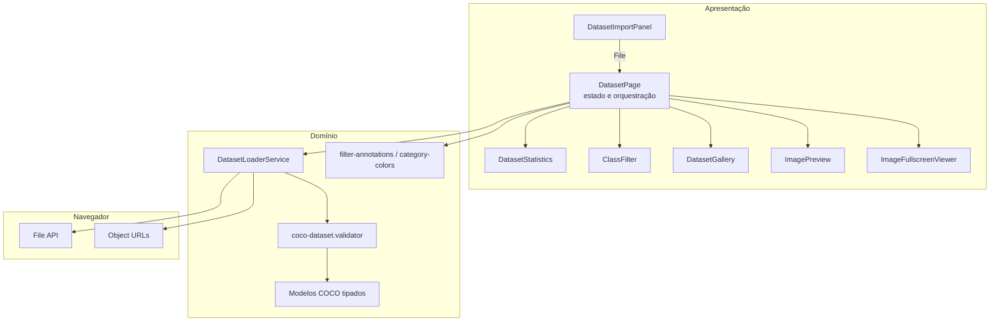
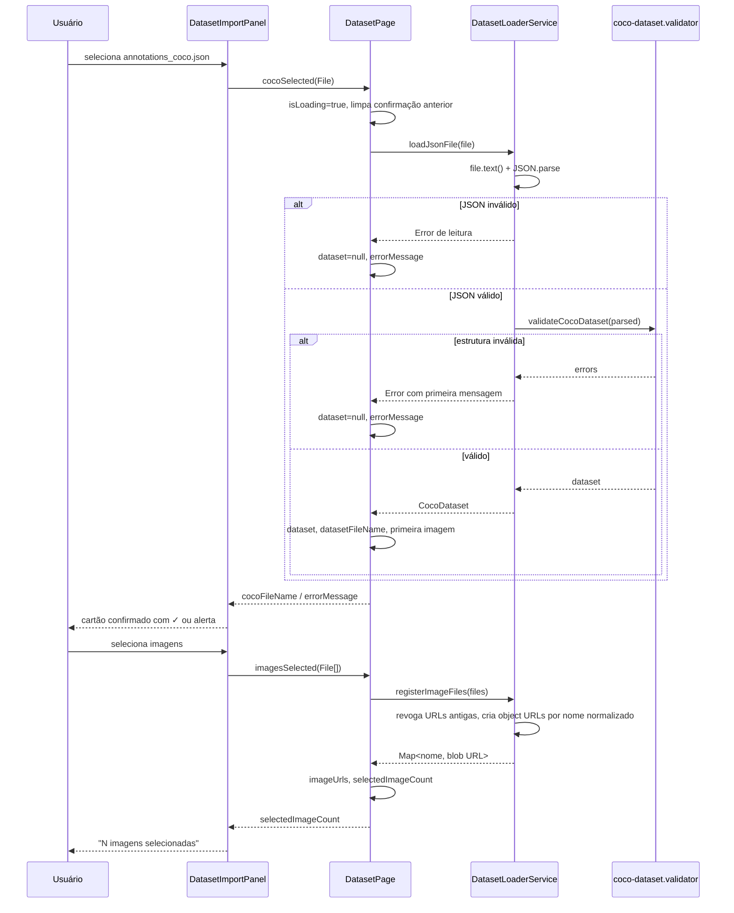
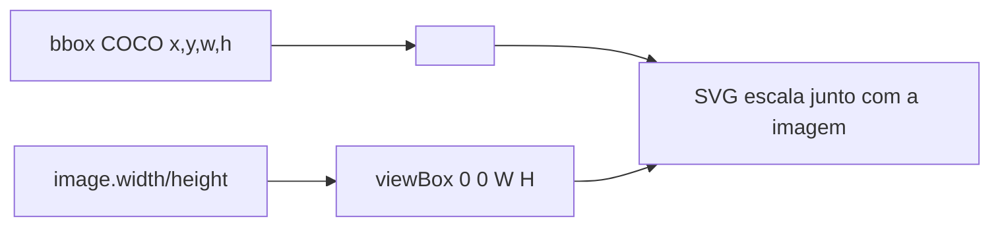
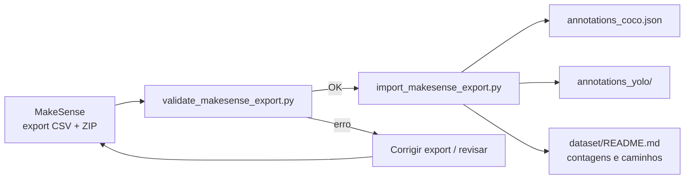

# Arquitetura

Documento de referência da aplicação Angular e do pipeline de dados do projeto. Descreve o que está implementado hoje, não um plano futuro. Decisões pontuais e suas justificativas estão registradas em [`decisoes-tecnicas.md`](decisoes-tecnicas.md).

## 1. Visão geral

O projeto tem duas partes independentes:

| Parte         | O que é                                                                     | Onde fica                     |
| ------------- | --------------------------------------------------------------------------- | ----------------------------- |
| Dataset       | 31 imagens com 269 anotações em COCO JSON e YOLO, com procedência por arquivo | `dataset/`                    |
| Aplicação web | Explorador client-side que valida o COCO, associa imagens e desenha caixas   | `app/`                        |
| Ferramentas   | Validadores/importador MakeSense e coletor de imagens                        | `tools/`                      |

A aplicação **não embute** o dataset. O usuário seleciona o JSON e as imagens no navegador; nenhum dado é enviado a um servidor. Todo o processamento ocorre em memória no cliente.

## 2. Camadas da aplicação



| Camada     | Responsabilidade                                                                 | Arquivos |
| ---------- | -------------------------------------------------------------------------------- | -------- |
| Página     | Concentra o estado da exploração, deriva listas/estatísticas e distribui inputs. | `features/dataset/pages/dataset-page.*` |
| Componentes | Apresentação pura: recebem `input()` e emitem `output()`, sem estado de domínio.  | `features/dataset/components/*` |
| Domínio    | Regras de validação, leitura de arquivo, associação de imagens e utilitários.    | `core/services/`, `core/validators/`, `core/utils/` |
| Contratos  | Tipos do formato COCO usados em toda a aplicação.                                | `core/models/coco-dataset.model.ts` |

### Componentes

| Componente             | Entradas principais                                                        | Saídas                          |
| ---------------------- | -------------------------------------------------------------------------- | ------------------------------- |
| `DatasetPage`          | —                                                                          | —                               |
| `DatasetImportPanel`   | `isLoading`, `errorMessage`, `missingImageCount`, `cocoFileName`, `selectedImageCount` | `cocoSelected`, `imagesSelected` |
| `DatasetStatistics`    | `categories`, `annotationCounts`, `imageCount`, `annotationCount`, `averagePerImage` | —                        |
| `ClassFilter`          | `categories`, `imageCounts`, `totalImageCount`, `selectedCategoryId`       | `categorySelected`              |
| `DatasetGallery`       | imagens filtradas, URL por imagem, contagem por imagem                     | seleção, abertura em tela cheia |
| `ImagePreview`         | `image`, `imageUrl`, `annotations`, `categories`, `annotationCount`, `datasetLoaded` | `expand`                |
| `ImageFullscreenViewer`| `image`, `imageUrl`, `annotations`, `categories`, `initialHiddenCategoryIds`, `position`, `total` | `closed`, `previous`, `next` |

Todos os componentes são `standalone: true` e usam `ChangeDetectionStrategy.OnPush`.

## 3. Fluxo de importação



Pontos importantes:

- A confirmação do JSON só aparece **depois** da validação bem-sucedida; uma nova tentativa limpa o estado anterior (ADR-012).
- Seleções vazias de imagens são ignoradas (`registerImages` retorna cedo).
- A associação imagem ↔ anotação é feita pelo **nome base normalizado** (`normalizeFileName`: remove diretórios e aplica minúsculas), não pelo caminho completo.

## 4. Estado da página

`DatasetPage` usa Signals. Valores derivados são `computed` e recalculados apenas quando a fonte muda.

| Signal                       | Tipo                          | Papel |
| ---------------------------- | ----------------------------- | ----- |
| `dataset`                    | `CocoDataset \| null`         | Dataset validado. |
| `imageUrls`                  | `ReadonlyMap<string,string>`  | Nome normalizado → object URL. |
| `selectedImageId`            | `number \| null`              | Imagem em prévia/tela cheia. |
| `selectedCategoryId`         | `number \| null`              | Filtro de classe ativo. |
| `isLoading`                  | `boolean`                     | Carregamento do JSON. |
| `errorMessage`               | `string \| null`              | Erro amigável de importação. |
| `hasImageSelection`          | `boolean`                     | Se o usuário já escolheu imagens. |
| `isFullscreen`               | `boolean`                     | Overlay de tela cheia aberto. |
| `datasetFileName`            | `string \| null`              | JSON confirmado. |
| `selectedImageCount`         | `number \| null`              | Imagens confirmadas. |

Derivados principais: `annotationCounts`, `annotationCountsByCategory`, `averageAnnotationsPerImage`, `imageCountsByCategory`, `filteredImages`, `annotationsByImage`, `selectedImage`, `selectedImageUrl`, `selectedAnnotations`, `allAnnotationsForSelectedImage`, `fullscreenInitialHiddenCategoryIds`, `missingImageCount`, `galleryEmptyMessage`.

### Regras de filtro e seleção

- `filteredImages` mantém a ordem do COCO e, com filtro ativo, inclui apenas imagens que têm ao menos uma anotação da classe.
- `selectCategory` troca a seleção para a primeira imagem visível se a imagem atual sair do filtro.
- `moveFullscreenSelection` navega dentro de `filteredImages` com **wrap-around**; é a mesma lista usada pela galeria.

## 5. Visualização das caixas

As caixas são desenhadas em **SVG** com o `viewBox` igual a `0 0 width height` da imagem original e `preserveAspectRatio="xMidYMid meet"`. As coordenadas COCO `[x, y, width, height]` são usadas diretamente, então o alinhamento independe do tamanho renderizado.



Cores vêm de `categoryColor(name)` em `core/utils/category-colors.ts`, garantindo a mesma cor na galeria, prévia, filtro e tela cheia.

## 6. Tela cheia e filtro por classe

O `ImageFullscreenViewer` é um overlay `position: fixed` com `role="dialog"` e `aria-modal="true"`.

| Comportamento            | Implementação |
| ------------------------ | ------------- |
| Abrir por botão          | `DatasetPage.openFullscreen` exige imagem selecionada. |
| Abrir por duplo clique   | `openImageFullscreen` exige que a imagem tenha URL carregada. |
| Navegar ←/→              | `keydown` no `document`, apenas quando aberto; usa `filteredImages`. |
| Fechar com Esc           | `closeButton`/`closed`; `DatasetPage.closeFullscreen`. |
| Travar rolagem           | `body.style.overflow='hidden'` ao abrir; restaurado em `ngOnDestroy`. |
| Foco                     | Foco inicial no diálogo e retorno ao elemento anterior ao fechar. |

### Filtro de classes (ADR-013)

- `hiddenCategoryIds` é um `linkedSignal` inicializado por `initialHiddenCategoryIds`.
- `categoryFilters` lista só as classes **presentes na imagem**, com contagem e rótulo acessível (`nome (N anotações)`).
- `visibleAnnotations` remove as classes ocultas; o SVG e o rodapé (`visíveis de total anot.`) refletem o resultado.
- **Marcar tudo** remove as classes da imagem do conjunto oculto; **Tirar tudo** adiciona todas.
- A seleção é preservada ao navegar entre imagens e reiniciada ao fechar o overlay.
- Se a página tem filtro de classe ativo, `fullscreenInitialHiddenCategoryIds` oculta todas as outras classes ao abrir, mantendo coerência com a prévia.

## 7. Pipeline do dataset

Alterações de anotação **não** são feitas à mão em COCO/YOLO. O fluxo obrigatório é:



| Etapa | Comando | Garantia |
| ----- | ------- | -------- |
| Coleta  | `tools/image-collector` | Baixa, valida formato/dimensões/hash e registra origem. |
| Validação | `python tools/dataset/validate_makesense_export.py --csv … --zip …` | Confere CSV e ZIP entre si e contra o COCO de referência; não escreve nada. |
| Importação | `python tools/dataset/import_makesense_export.py --csv … --zip …` | Gera COCO e YOLO a partir do par validado. |
| Correções | `dataset/annotations/makesense_source/corrections_*.json` | Registram ajustes pós-export para rastreabilidade. |

O par derivado vigente é `makesense_annotations_reviewed_2026-11-13.csv` + `makesense_yolo_export_reviewed_2026-11-13.zip`. Detalhes em [`../dataset/README.md`](../dataset/README.md).

## 8. Performance

| Decisão | Motivo |
| ------- | ------ |
| `OnPush` em todos os componentes | Reduz verificações a entradas/sinais alterados. |
| `computed` para derivados | Recalcula apenas quando a fonte muda. |
| `track` por ID em todos os `@for` | Evita recriação de DOM. |
| `loading="lazy"` nas miniaturas | Não baixa/decodifica imagens fora da viewport. |
| Object URLs + revogação | Evita vazamento de memória ao trocar seleção. |
| SVG com `viewBox` | Sem recálculo de coordenadas no resize. |
| HTML/CSS nativo | Sem biblioteca de UI adicional. |

Medição mais recente: build de produção com **279,76 kB** iniciais (≈ 74,39 kB transferidos), abaixo do limite de erro de 1 MB configurado no Angular. Não há medição automatizada de FPS, memória ou teste de carga; a suíte atual usa 31 imagens.

## 9. Acessibilidade

- Diálogo com `role="dialog"`, `aria-modal`, rótulo com o nome do arquivo e posição anunciada por `aria-live`.
- Checkboxes de classe com `aria-label` contendo nome e contagem; barra com `role="group"`.
- Foco inicial no diálogo e restauração ao fechar; `Esc` fecha.
- Mensagens de erro em `role="alert"`; confirmação de importação em `role="status"`.
- Controles principais operáveis por teclado, mouse e toque; texto com tamanho responsivo.
- A conferência visual em navegador/dispositivo real **não foi registrada** nesta revisão.

## 10. Segurança e privacidade

- 100% client-side: nenhum upload para servidor, sem autenticação, sem persistência remota.
- O JSON é tratado como `unknown` e validado antes do uso; campos ausentes ou inválidos geram erro amigável.
- Apenas arquivos `image/*` viram object URLs; nomes de arquivo são normalizados.
- Não há `innerHTML`, `eval` nem execução de conteúdo do dataset.
- Limitação: um JSON muito grande pode consumir memória do navegador; não há limite de tamanho imposto pela aplicação.

## 11. Estratégia de testes

| Arquivo de teste | Foco |
| ---------------- | ---- |
| `coco-dataset.validator.spec.ts` | Estrutura, campos obrigatórios, referências e mensagens. |
| `dataset-loader.service.spec.ts` | Leitura, JSON inválido, object URLs e liberação. |
| `filter-annotations.spec.ts` | Filtro puro por categoria. |
| `dataset-page.spec.ts` | Upload nas duas ordens, confirmação, erros, imagens ausentes, estatísticas, filtro e integração com a tela cheia. |
| `image-fullscreen-viewer.spec.ts` | Diálogo, teclado, foco, rolagem, navegação, duplo clique e filtro por classe. |

Total atual: **35 testes em 5 arquivos**, executados com Vitest via `@angular/build:unit-test`. Os testes usam arquivos sintéticos e **não escrevem no dataset real**.

Não executado: E2E em navegador real, teste multi-dispositivo e teste de carga. Nenhum resultado não executado é apresentado como aprovado.

## 12. Estrutura de diretórios

```text
app/src/app/
├── app.config.ts            # provideRouter + listeners globais
├── app.routes.ts            # rota única → DatasetPage
├── app.ts / app.html / app.scss
├── core/
│   ├── models/coco-dataset.model.ts
│   ├── services/dataset-loader.service.ts
│   ├── utils/category-colors.ts
│   ├── utils/filter-annotations.ts
│   └── validators/coco-dataset.validator.ts
└── features/dataset/
    ├── pages/dataset-page.ts|html|scss
    └── components/
        ├── class-filter.*
        ├── dataset-gallery.*
        ├── dataset-import-panel.*
        ├── dataset-statistics.*
        ├── image-preview.*
        └── image-fullscreen-viewer.*
```
